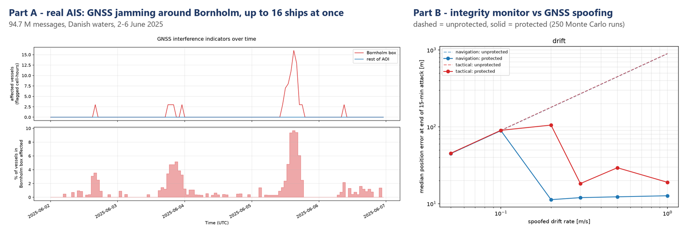
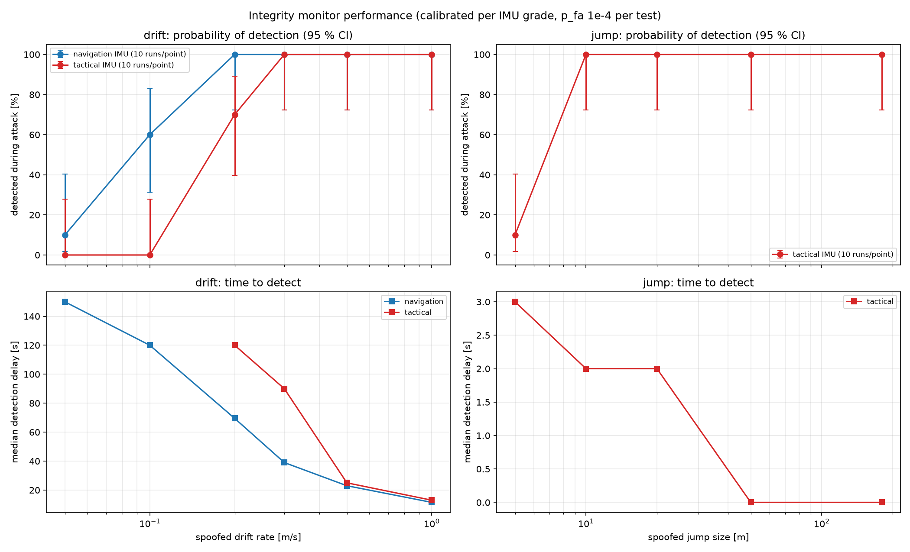
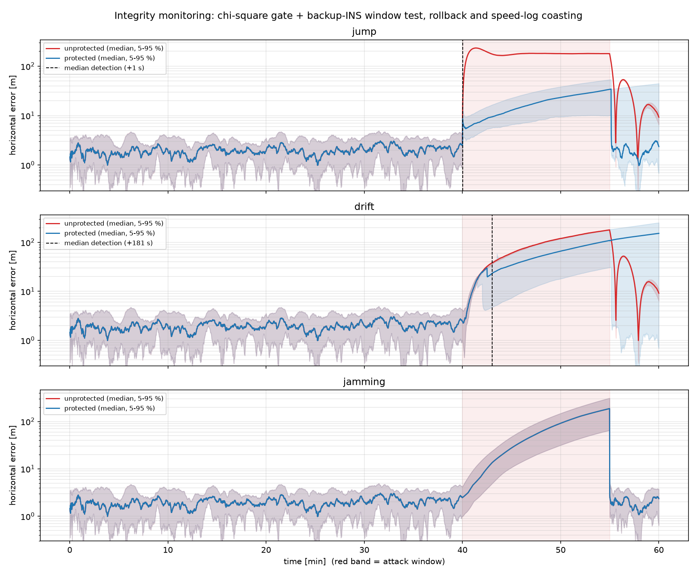

# Maritime AIS Intelligence & GNSS Resilience

**What AIS reveals about vessel behaviour and GNSS interference — and how a ship's
navigation can survive GNSS spoofing and jamming.**

- **Part A – AIS analytics on real data.** 94.7 M AIS messages from the Danish Maritime
  Authority (2–6 June 2025): cleaning, dark activity, ship-to-ship encounters, GNSS
  interference indicators and ETA prediction.
- **Part B – GNSS-resilient navigation (simulation).** A loosely coupled INS/GNSS
  error-state EKF, attacked by spoofing (jump, slow drift) and jamming, protected by an
  integrity monitor and evaluated by Monte Carlo.
- **Part C – Streamlit dashboard** presenting both.

All numbers below are reproducible from [config/default.yaml](config/default.yaml) (fixed
seeds) and are listed in full in [RESULTS.md](RESULTS.md). Every known caveat is in
[LIMITATIONS.md](LIMITATIONS.md).



<!-- Demo video (2 min): add the link here once uploaded -->

## Key results

| | Result |
|---|---|
| **AIS cleaning** | 94.7 M messages → 53.0 M clean fixes from 8,950 vessels; 35 % were multi-station duplicates. Two AIS artefacts (stale re-stamped fixes, 1/10′ long-range reports) found by inspecting false jumps, cutting them from 6 to 0 in a sample. Processing: ~27 s/day on an 8 GB laptop. |
| **Dark activity** | 12,095 AIS gaps ≥ 2 h reduced to 2,268 unexplained after testing port/anchorage, receiver coverage (learned from the data) and position jumps; 5 commercial "moved while dark" candidates, 2 unexplained after manual triage. |
| **Ship-to-ship** | KD-tree pairing per 5-min bin: 1.4 s instead of 81.9 M pairwise distances. 2,534 encounters; tanker bunkering at the Skagen anchorage identified; berths in small harbours removed with a coastline test. |
| **GNSS interference** | All 24 flagged cell-hours lie around Bornholm, peaking on 5 June 2025 (up to 16 vessels, 9.7 % of those present). Jump destinations never converge → consistent with jamming rather than coordinated spoofing. |
| **ETA** | Gradient boosting 6.4 h MAE vs 9.6 h for dead reckoning (−33 %) on a time split. 22 % of AIS-reported (manually entered) ETAs were already in the past; when current they are the best predictor (3.2 h). |
| **INS/GNSS EKF** | 8-state error-state EKF, consistent (NEES ≈ n) with white GNSS noise, 5× better than raw GNSS. With realistic time-correlated GNSS error it becomes ~10× overconfident while the NIS looks normal — the blind spot a slow spoofer exploits. |
| **Attacks** | A 0.2 m/s spoofed drift pulls the unprotected filter 180 m in 15 min while the per-epoch χ² test fires on 0.4 % of epochs (0.14 % without attack). 15-min jamming: 187 m vs 1,487 m for an uncalibrated INS. |
| **Integrity monitor** | χ² gate + backup-INS window test with rollback, speed-log coasting and calibrated thresholds. **0 false alarms in 20 h** (tactical IMU); jumps ≥ 10 m detected in ≤ 2 s; spoofed drift detected in 100 % of runs from **0.3 m/s with a tactical MEMS** and from **0.2 m/s with a navigation-grade FOG**; 270–900 m spoofed offsets reduced to 12–29 m. |



## Approach

### Part A — AIS on real data (`src/maritime/ais/`)

| Phase | What | How |
|---|---|---|
| A1 | Ingestion & cleaning | Polars streaming, one day at a time; MMSI MID range, AIS "not available" sentinels, duplicates, stale repeats, coarse long-range fixes, isolated-spike removal. Physically impossible relocations are **flagged, not deleted** — they are the spoofing signal for A4. Multi-day trajectories in 16 hashed MMSI buckets. |
| A2 | Dark activity | Gaps between trajectory segments; benign explanations tested in order: port/anchorage (World Port Index + learned anchorages), empirical receiver coverage (other vessels heard in the same cell-hour), position jump. Abrupt U-turns / stops as context events. |
| A3 | Ship-to-ship | Slow vessels outside routine zones, one mean position per 5 min, `cKDTree.query_pairs` per bin, chained into ≥ 1 h episodes; pair classification and dark-gap context. |
| A4 | GNSS interference | Distinct vessels per 0.5° cell-hour with impossible jumps or fixes deep inland after a jump (Natural Earth land); convergence test for coordinated spoofing; daily heatmap and time series. |
| A5 | ETA | Arrivals = port-zone entries with a stopped stay; at-sea samples every 30 min up to 48 h; dead reckoning vs `HistGradientBoostingRegressor` on log-hours vs the AIS-reported ETA; time split by arrival. |

### Part B — GNSS-resilient navigation (`src/maritime/nav/`)

| Phase | What | How |
|---|---|---|
| B1 | Simulation | Ship truth at 100 Hz; IMU error model (turn-on bias, Gauss–Markov bias instability, ARW/VRW) for tactical MEMS and navigation FOG; GNSS with white + correlated error; speed log through water. Validated by Allan deviation against closed-form theory (ARW recovered 0.151 vs 0.15 °/√h). |
| B2 | EKF | 2D error-state EKF (δp, δv, δψ, accelerometer and gyro biases), Joseph update; linearisation unit-tested against nonlinear propagation; NEES/NIS Monte Carlo consistency; heading observability in turns. |
| B3 | Attacks | Spoofing jump, meaconing-style slow drift, jamming outage; paired Monte Carlo on the unprotected filter; drift-stealth sweep. |
| B4 | Integrity monitor | Per-epoch χ² gate (jumps) + **backup INS** snapshots that never see GNSS, tested against GNSS after 2 min (slow drift); **rollback** onto the clean backup; coasting with speed-log + non-holonomic aiding; quarantine and consistency-based re-admission. Thresholds calibrated on independent attack-free Monte Carlo (scaled χ², tail-matched). |
| B5 | Evaluation | 250 one-hour runs in a process pool; paired protected/unprotected runs; detection probability (Wilson 95 % CI), delay, false alarms and error reduction vs drift rate, jump size and IMU grade. |



## Run it

Requires Python 3.12–3.13. On Windows use `.venv\Scripts\python.exe` in place of `python`.

```bash
uv venv --python 3.13 .venv
uv pip install -e ".[all,dev]"
pytest                                   # 171 tests
```

**Dashboard** (works straight from a clone: it reads the small bundle in `outputs/dashboard/`):

```bash
streamlit run app/streamlit_app.py
```

**Reproduce everything** (Part A downloads ~3.3 GB of DMA data into `data/`):

```bash
python -m maritime a1      # download, clean, trajectories      (~1 h, network bound)
python -m maritime a2      # dark activity                       (~30 s)
python -m maritime a3      # ship-to-ship encounters             (~10 s)
python -m maritime a4      # GNSS interference                   (~1-2 min)
python -m maritime a5      # ETA                                 (~1 min)
python -m maritime b1      # sensor simulation, INS drift, Allan (~30 s)
python -m maritime b2      # EKF Monte Carlo                     (~4 min)
python -m maritime b3      # attacks, unprotected                (~3 min)
python -m maritime b4      # integrity monitor                   (~5 min)
python -m maritime b5      # parallel Monte Carlo study          (~7 min, 4 cores)
python -m maritime dashboard-data
```

## Repository layout

```
config/default.yaml        every parameter, threshold, date, area and seed
src/maritime/ais/          Part A: download, clean, trajectories, dark, encounters,
                           gnss_anomaly, eta, vessels, pipeline
src/maritime/nav/          Part B: trajectory, sensors, ins, ekf, attacks, integrity,
                           montecarlo, pipeline
src/maritime/zones.py      ports (WPI) and learned anchorages, shared by A2-A5
src/maritime/geo.py        geodesy (haversine, bearings, UTM 32N)
app/streamlit_app.py       Part C dashboard
tests/                     171 pytest tests
outputs/figures, tables    committed results; outputs/dashboard = dashboard bundle
RESULTS.md, LIMITATIONS.md every metric, every caveat
```

## Honest limitations (short version)

- AIS is self-reported and terrestrial-only; a gap can be a reception artefact and "dark" is
  never proof of intent. The interference finding has no public ground truth to validate.
- Part B is a 2D, flat-Earth simulation (no Schuler loop, no Earth rate, no sea-state
  dynamics); the attack model is an offset on position, not a receiver-level spoofer.
- The integrity monitor has a physical detection limit (≈ 0.2–0.3 m/s drift) and a
  fundamental ambiguity once GNSS and INS disagree for long; resolving it needs an
  independent reference (radar/visual fix, eLoran) and the officer of the watch.

Full list: [LIMITATIONS.md](LIMITATIONS.md).

## Data and credits

- AIS: [Danish Maritime Authority](http://aisdata.ais.dk/) daily files.
- Ports: NGA World Port Index (Pub. 150). Land: [Natural Earth](https://www.naturalearthdata.com/) 1:10M.
- Built by Themistoklis Sakkas (naval navigation background; MSc Guided Weapon Systems,
  Cranfield; MSc Shipping, University of the Aegean).

## License

Code released under the [MIT License](LICENSE). AIS data, the World Port Index and Natural Earth remain under their own terms.
